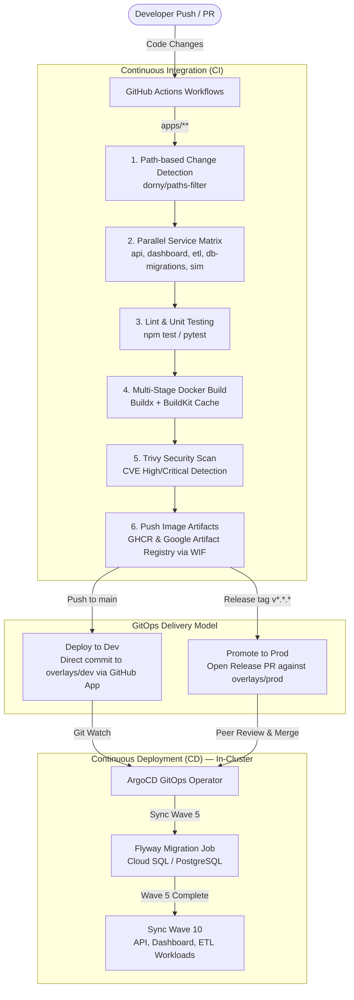

# 🚀 CI/CD Pipelines & GitOps Automation (`.github/`)

This directory contains the automated CI/CD workflows, custom actions, and GitOps governance configurations that drive the **Fire Monitoring System**. The platform enforces an immutable, pull-based delivery model where all production state transitions are mediated through Git.

---

## 🏗️ Architecture & Pipeline Flow

---

## 📂 Workflow Catalog (`.github/workflows/`)

| Workflow File | Trigger Events | Purpose & Responsibilities |
|---|---|---|
| [**`app-pipeline.yml`**](./workflows/app-pipeline.yml) | `push` to `main`, `pull_request` on `apps/**`, `tags: v*.*.*`, `workflow_dispatch` | Core application CI/CD pipeline: runs lint/unit tests, multi-stage Docker builds, Trivy CVE vulnerability scans, dual-registry push (GHCR + GAR), and automated Kustomize image tag bumps. |
| [**`k8s-manifest-validation.yml`**](./workflows/k8s-manifest-validation.yml) | `pull_request` on `infrastructure/k8s/**`, `push` to `main` | Validates Kustomize builds across all overlays (`local`, `dev`, `prod`), ensuring zero syntax errors or broken resource references before merge. |
| [**`gcp-terraform-deploy.yml`**](./workflows/gcp-terraform-deploy.yml) | `push` to `main` on `infrastructure/terraform/**`, `workflow_dispatch` | Orchestrates sequential Terraform layer deployment (`01-infra`, `02-platform`, `03-argocd`) using GCP Workload Identity Federation (WIF). |
| [**`gcp-terraform-reusable.yml`**](./workflows/gcp-terraform-reusable.yml) | Called by `gcp-terraform-deploy.yml` | Reusable workflow module executing Terraform `init`, `validate`, `plan`, and `apply` with state isolation. |
| [**`terraform-pr-plan.yml`**](./workflows/terraform-pr-plan.yml) | `pull_request` modifying Terraform code | Generates speculative Terraform execution plans and posts diff summaries directly into PR discussion threads. |
| [**`local-cluster-notify.yml`**](./workflows/local-cluster-notify.yml) | `push` to `main` | Dispatches cluster event notifications to local sandboxes. |

---

## ⚙️ Application CI/CD Lifecycle (`app-pipeline.yml`)

The primary application delivery pipeline operates in four coordinated phases:

### 1. Matrix Change Detection
Uses `dorny/paths-filter` to evaluate pull requests and commits against specific service directories:
* `apps/api/**` → `api`
* `apps/dashboard/**` → `dashboard`
* `apps/etl-processor/**` → `etl-processor`
* `apps/db-migrations/**` → `db-migrations`
* `apps/simulators/**` → `mcu-simulator`

Only modified services enter the build and test matrix. On release tags (`v*.*.*`) or manual dispatch, all 5 services build simultaneously.

### 2. Lint & Unit Testing
Executes service-specific verification before compiling containers:
* **API**: `npm ci`, ESLint checks, and Jest unit tests (`npm test`).
* **ETL Processor**: Python virtual environment setup, pip installation, and `pytest` suite execution.

### 3. Multi-Stage Build & Trivy Security Gate
* Images are built using `docker/build-push-action` with GitHub Actions cache backend (`type=gha`).
* **Trivy Vulnerability Scan**: Scans local images for OS and package CVEs (`HIGH`, `CRITICAL`) using `.trivyignore` baseline filtering before publishing to registries.
* **Dual Registry Publishing**:
  * **GitHub Container Registry (GHCR)**: `ghcr.io/fauxx/firemonitoringsystem-v2/<service>:<tag>`
  * **Google Artifact Registry (GAR)**: `asia-east1-docker.pkg.dev/firemonitoring-dev/firemonitoring-dev/<service>:<tag>` authenticated via passwordless GCP Workload Identity Federation (WIF).

### 4. Automated GitOps Promotion
* **Staging (`gke-dev`)**: On merge to `main`, uses a short-lived GitHub App installation token to update the image tags in [infrastructure/k8s/overlays/dev/kustomization.yaml](../infrastructure/k8s/overlays/dev/kustomization.yaml) with `[skip ci]`.
* **Production (`gke-prod`)**: On publishing a semver Git tag (`v*.*.*`), automatically generates an isolated release branch (`release/prod-v*.*.*`), updates [infrastructure/k8s/overlays/prod/kustomization.yaml](../infrastructure/k8s/overlays/prod/kustomization.yaml), and opens a **Production Promotion Pull Request** with a change summary checklist.

---

## 🔒 Zero-Trust Security & Secrets Architecture

1. **Passwordless Cloud Authentication (Workload Identity Federation)**:
   * Replaces static, high-risk Google Cloud JSON service account keys with OpenID Connect (OIDC) federation.
   * GitHub Actions exchanges its ephemeral OIDC JWT token with GCP IAM to assume the `ci-builder` service account.
2. **Ephemeral GitHub App Tokens**:
   * CI Git mutations (committing dev tags, opening promotion PRs) authenticate via a dedicated GitHub App rather than personal access tokens (PATs).
   * Short-lived tokens are minted at runtime (`actions/create-github-app-token`), expiring within one hour.
3. **Environment Isolation**:
   * Pipeline stages are bound to GitHub Environments (`gke-dev`, `gke-prod`).
   * Production promotions require explicit environment approval rules and restricted secret scoping.

---

## 🚢 In-Cluster ArgoCD Synchronization

ArgoCD continuously observes the Git repository and reconciles discrepancies:
* **Automated Sync & Self-Healing**: Automatically heals cluster state drift when manifests are updated in Git.
* **Sync Wave Execution**:
  * **Wave 5**: Runs the ephemeral `flyway-migrate` Kubernetes Job to execute pending PostgreSQL DDL migrations.
  * **Wave 10**: Boots the updated application microservices (`api`, `dashboard`, `etl-processor`) only after database migrations complete successfully, guaranteeing zero-downtime rollouts.
