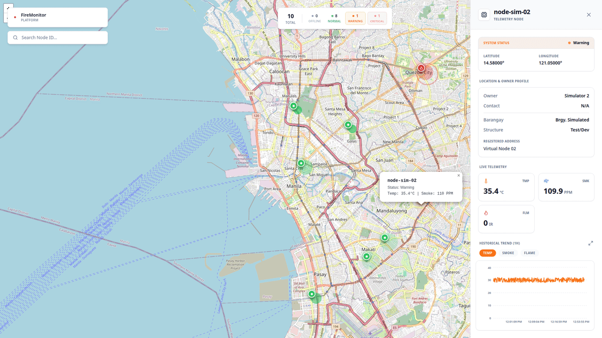
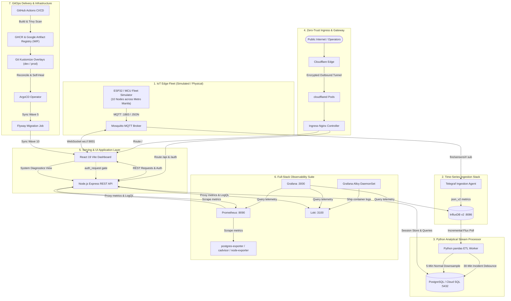

<div align="center">

# 🔥 IoT-Based Fire Monitoring & Cloud-Native Analytics Command Center

[](https://opensource.org/licenses/MIT)
[](https://cloud.google.com/kubernetes-engine)
[](https://cloud.google.com/)
[](https://www.terraform.io/)
[](https://argoproj.github.io/cd/)
[](https://www.cloudflare.com/)
[](https://cloud.google.com/sql)
[](https://www.influxdata.com/)
[](https://react.dev/)
[](https://nodejs.org/)
[](https://www.python.org/)
[](https://prometheus.io/)
[](https://grafana.com/)
[](https://trivy.dev/)

*An enterprise-grade Cloud-Native Platform, GitOps delivery pipeline, and Zero-Trust Security architecture for real-time IoT fire telemetry and emergency analytics.*

</div>

---

## 📸 Live Command Center Showcase

<div align="center">
  
  <p><em>Real-time streaming telemetry with sub-second MQTT updates and bi-directional IoT edge simulation control.</em></p>
</div>

| 🗺️ 3D Spatial Command Center | 🔍 Edge Sensor Telemetry Drawer |
|:---:|:---:|
|  |  |
| *Live MapLibre GL map with animated severity markers in NCR* | *Sub-second sensor tracking (temp, smoke, flame, battery)* |

| 🎮 Bi-Directional IoT Simulation Controller | 🔐 Encrypted Session Authentication & RBAC |
|:---:|:---:|
|  |  |
| *Real-time status overrides & power toggles over WebSockets* | *Gated approval queue & connect-pg-simple session store* |

---

## 🛰️ High-Level System Architecture & Ingestion Flow

The platform implements an end-to-end reactive streaming pipeline: high-frequency IoT sensor telemetry is ingested into time-series storage, continuously evaluated and debounced by an analytical stream processor, persisted to a normalized relational database, and exposed through a Zero-Trust gateway to an operator command center with full-stack observability.

<div align="center">
  
</div>

<details>
<summary><b>🔍 View Raw Mermaid Diagram Specification</b></summary>



</details>

### 🔄 End-to-End Ingestion Flow Stages

1. **Edge Telemetry Generation (`apps/simulators/`)**:
   * Physical ESP32 microcontrollers or the Python IoT Fleet Simulator publish flat JSON payloads (`h_id`, `status`, `temp`, `smoke`, `flame`, `_time`) every 5 seconds to MQTT topic `fire/sensors/{device_id}` on Mosquitto (port `1883`).
2. **Time-Series Ingestion Stack (`base/data/`)**:
   * The **Telegraf** ingestion agent subscribes to `fire/sensors/#`, parses the telemetry using `json_v2`, and continuously writes high-frequency time-series measurements into **InfluxDB v2** (`sensor-data` bucket).
3. **Analytical Stream Processing & Debouncing (`apps/etl-processor/`)**:
   * The **Python pandas ETL Worker** polls InfluxDB using incremental Flux range queries with high-watermark timestamp tracking.
   * **30-Minute Anomaly Debouncer**: When alert status (`1` Warning or `2` Critical) is observed, it checks for an existing active session in `historical_fire_incidents` for that household (`h_id`). If found within 30 minutes, it updates `last_seen_at`, updates running weighted averages of temperature, smoke, and flame, and escalates severity. If no active session exists, a new incident record is initialized.
   * **5-Minute Routine Downsampler**: Normal status telemetry (`status == 0`) is aggregated into 5-minute interval buckets (`interval_time`), slashing relational storage consumption by >90%.
   * **Auto-Resolution**: Once normal telemetry resumes with timestamps after the anomaly, active incidents are marked resolved (`is_active = FALSE`).
4. **Zero-Trust Network Routing (`infrastructure/k8s/base/networking/`)**:
   * Inbound traffic from operators bypasses open public node ports via **Cloudflare Zero Trust Tunnels** (`cloudflared`), which establish encrypted outbound connections to Cloudflare Edge.
   * `ingress-nginx` terminates edge traffic internally and evaluates path-based routing rules (`/` to Dashboard, `/api` and `/auth` to Express API, `/mqtt` WebSocket to Mosquitto).
5. **Live Operator Serving & Control (`apps/dashboard/` & `apps/api/`)**:
   * The **React 19 Command Center Dashboard** subscribes to real-time telemetry over WebSockets (`ws://host:9001`), rendering live 3D MapLibre maps and animated incident markers with sub-second latency.
   * Operators can publish bi-directional overrides to `fire/control/{h_id}` or `fire/control/all` directly from the UI simulation controller modal.
   * The **Node.js Express API** validates user authentication via `connect-pg-simple` session tables and executes parameterized queries against Cloud SQL PostgreSQL.
6. **Unified Observability Suite (`base/observability/`)**:
   * **Prometheus** scrapes container metrics (`cadvisor`), node metrics (`node-exporter`), database metrics (`postgres-exporter`), and API latency histograms (`prom-client`).
   * **Grafana Alloy** DaemonSet forwards pod logs to **Loki**; the Express API proxies Prometheus and Loki queries directly to the dashboard's integrated System Diagnostics suite.
7. **Declarative GitOps & Delivery (`.github/` & ArgoCD)**:
   * GitHub Actions runs tests, multi-stage Docker builds, and Trivy CVE scans, pushing to GHCR and Google Artifact Registry via GCP Workload Identity Federation (WIF).
   * Image tags are committed to Kustomize overlays. **ArgoCD** continuously reconciles cluster state in sequential sync waves: **Wave 5** executes the `flyway-migrate` schema upgrade Job, and **Wave 10** rolls out application pods.

---

## 📂 System Component Directory Mapping

---

### 🟢 1. Node.js Express REST API ([`apps/api/`](./apps/api/))
*   **Architectural Role**: The central data orchestrator and user session controller. Interfaces with managed PostgreSQL (Google Cloud SQL), manages authenticated user sessions, aggregates sensor statistics, exposes Prometheus instrumentation, and proxies in-cluster observability feeds (Prometheus and Loki) directly to the frontend.
*   **Key Implementations**:
    *   **Persistent Sessions**: Integrates `express-session` with `connect-pg-simple` and explicit asynchronous `req.session.save()` on login, eliminating session drops during pod restarts and rapid navigation.
    *   **In-Cluster Observability Proxy**: Exposes `/api/observability/metrics` (Prometheus CPU/RAM metrics) and `/api/observability/logs` (Loki LogQL container streaming with container alias mapping and dynamic namespace discovery).
    *   **Cloud SQL Auth Proxy**: Connects via local Cloud SQL Proxy sidecar containers with IAM Workload Identity authentication.
    *   **Hardened Multi-Stage Build**: Isolates native `bcrypt` compilation tools to the build stage; runs as non-root `node:node` (`UID 1000`).
*   👉 [**Express REST API Complete Guide 📖**](./apps/api/README.md)

---

### 🔴 2. React 19 Command Center Dashboard ([`apps/dashboard/`](./apps/dashboard/))
*   **Architectural Role**: High-performance, real-time spatial analytics and control interface built with React 19, TypeScript, Vite, and Tailwind CSS.
*   **Key Implementations**:
    *   **3D Spatial Visualization**: Uses MapLibre GL and WebGL/Three.js (`react-globe.gl`) to project live sensor nodes onto vector maps with animated severity rings and auto-framing around Metro Manila (NCR) coordinates.
    *   **Sub-Second MQTT WebSockets**: Subscribes directly to `fire/sensors/#` over WebSockets, eliminating HTTP polling overhead. Dynamic hooks (`useLiveSensors`, `useDashboardData`) track real-time heartbeat timeouts to detect online/warning/offline sensor states.
    *   **Bi-Directional Simulation Controller**: Operators can trigger heat spikes, toggle device power (ON/OFF), or override alert states (Normal/Warning/Critical) in real time over `fire/control/{h_id}`.
    *   **Zero-Placeholder Diagnostics**: Live System Diagnostics modal displays real-time Prometheus CPU/RAM graphs and interactive Loki container log streams.
*   👉 [**React Command Center Complete Guide 📖**](./apps/dashboard/README.md)

---

### 🟡 3. Python pandas ETL Processor ([`apps/etl-processor/`](./apps/etl-processor/))
*   **Architectural Role**: High-throughput analytical stream worker bridging time-series telemetry in InfluxDB with relational analytical tables in PostgreSQL.
*   **Key Implementations**:
    *   **30-Minute Anomaly Debouncing**: Identifies active fire incidents for a household tag. If active within 30 minutes, it updates `last_seen_at`, escalates severity to `GREATEST(status, max_status)`, and recomputes running weighted averages of temperature, smoke density, and flame intensity. When normal telemetry resumes, it automatically marks incidents resolved.
    *   **5-Minute Routine Downsampling**: Normal telemetry (`status == 0`) is aggregated into 5-minute interval rollups (`dt.floor("5min")`), slashing database storage bloat by over 90%.
    *   **Multi-Stage Wheel Builder**: Compiles binary `.whl` dependencies in Stage 1 and runs on a lightweight `python:3.12-slim` image with only runtime `libpq5`, eliminating heavy C-compilers (`gcc`) from production images.
*   👉 [**Python pandas ETL Complete Guide 📖**](./apps/etl-processor/README.md)

---

### 🟣 4. IoT Fleet Simulator ([`apps/simulators/`](./apps/simulators/))
*   **Architectural Role**: Asynchronous Python MQTT service emulating physical ESP32 microcontrollers streaming real-world fire sensor telemetry.
*   **Key Implementations**:
    *   **10-Device Fleet Runner**: Spawns 10 concurrent processes mapped to real-world NCR coordinates in `device_registry` (Intramuros, Ermita, Malate, Sampaloc, Tondo, Pandacan).
    *   **Bi-Directional MQTT Controls**: Subscribes to `fire/control/{h_id}` and `fire/control/all` to dynamically pause/resume publishing or force simulated alarm escalations.
    *   **Rootless Pod Security**: Packages on `python:3.12-slim` executing under dedicated unprivileged user `simuser` (`UID 1000`).
*   👉 [**IoT Fleet Simulator Complete Guide 📖**](./apps/simulators/README.md)

---

### 🗄️ 5. Database Migrations ([`apps/db-migrations/`](./apps/db-migrations/))
*   **Architectural Role**: Declarative DDL schema migration management using Flyway 10.
*   **Key Implementations**:
    *   **19 Versioned Migrations (`V1`–`V19`)**: Manages relational schema evolution from initial user and incident tables, persistent session storage (`connect-pg-simple`), normalized 3NF `device_registry`, to high-precision NCR GPS coordinates.
    *   **ArgoCD PreSync Wave 5**: Deploys as an ephemeral Kubernetes Job on **Sync Wave 5**, ensuring schema migrations complete successfully before application pods boot on **Sync Wave 10**.
    *   **Cloud SQL Integration**: Connects securely to Google Cloud SQL via Cloud SQL Auth Proxy sidecars.
*   👉 [**Database Migrations Complete Guide 📖**](./apps/db-migrations/README.md)

---

### 🟤 6. Multi-Layer Terraform IaC ([`infrastructure/terraform/`](./infrastructure/terraform/))
*   **Architectural Role**: Infrastructure-as-code orchestration provisioning cloud infrastructure and platform services on Google Cloud Platform (GCP).
*   **Key Implementations**:
    *   **4-Layer Sequential Orchestration**:
        *   `00-bootstrap`: Sets up Workload Identity Federation (WIF) pools, CI Service Accounts, and GCS remote backend.
        *   `01-infra`: Provisions custom VPC, private GKE cluster with Dataplane V2 (eBPF), and Cloud SQL PostgreSQL instance.
        *   `02-platform`: Deploys cluster Helm charts (`ingress-nginx` with `externalTrafficPolicy: Local`, `cert-manager`).
        *   `03-argocd`: Syncs GitHub App credentials and registers the root ArgoCD `App-of-Apps` application.
    *   **State Isolation**: Environment and layer state isolation in Google Cloud Storage (`gs://firemonitoring-tfstate`).
*   👉 [**Terraform IaC Complete Guide 📖**](./infrastructure/terraform/README.md)

---

### ☸️ 7. Kubernetes GitOps Manifests & Ingress ([`infrastructure/k8s/`](./infrastructure/k8s/))
*   **Architectural Role**: Declarative Kubernetes manifests and Kustomize overlays reconciled continuously by ArgoCD.
*   **Key Implementations**:
    *   **Base & Overlay Topology**: Base manifests partitioned by architectural domain (`apps/`, `data/`, `observability/`, `networking/`), with specialized overlays for `local` (Kind), `dev` (staging at `dev.fires.systems`), and `prod` (production at `fires.systems`).
    *   **Zero-Trust Networking**: Default-deny NetworkPolicies enforce strict pod-to-pod isolation. Cloudflare Tunnels (`cloudflared`) establish encrypted outbound-only tunnels to the Cloudflare Edge, eliminating open public node ports.
    *   **ArgoCD Sync Waves**: Wave 5 executes database migrations; Wave 10 rolls out application workloads.
*   👉 [**Kubernetes Manifests & Ingress Complete Guide 📖**](./infrastructure/k8s/README.md)

---

### 🚀 8. Automated CI/CD Pipelines ([`.github/`](./.github/))
*   **Architectural Role**: Automated GitHub Actions pipelines governing continuous integration, runtime Kubernetes validation, security gates, container publishing, and GitOps image promotion.
*   **Key Implementations**:
    *   **Matrix Change Detection**: Uses `dorny/paths-filter` to build and test only the services with code modifications (`apps/**`).
    *   **Automated Kind Runtime Smoke Tests**: Provisions an ephemeral Kind cluster directly in GitHub Actions runners (`helm/kind-action`), builds & loads container images, deploys Kustomize manifests (`overlays/local`), verifies pod rollouts with zero `CrashLoopBackOff`, and curls backend `/health` endpoints prior to PR merge.
    *   **Security & CVE Gates**: Automated linting, unit tests (`npm test`, `pytest`), and Trivy container vulnerability scanning before pushing to GHCR and Google Artifact Registry (GAR).
    *   **Passwordless Workload Identity Federation (WIF)**: Ephemeral OIDC authentication with GCP, completely removing long-lived JSON service account keys.
    *   **Automated GitOps Tag Promotion**: Merges to `main` commit image tag updates to `overlays/dev` via a GitHub App token; semver Git release tags (`v*.*.*`) automatically open a Production Promotion PR against `overlays/prod`.
*   👉 [**CI/CD Pipelines & Automation Guide 📖**](./.github/README.md)

---

## 🚦 Developer Tooling & SDLC Lifecycle

The repository follows a modern Cloud-Native SDLC that offloads resource-heavy Kubernetes runtime validation from developer workstations into automated GitHub Actions CI runners, pairing lightweight local iterations with bulletproof CI gates:

```
┌──────────────────────────┐      ┌──────────────────────────┐      ┌─────────────────────────┐      ┌────────────────────────┐
│  1. Fast Local Dev       │ ──►  │  2. Ephemeral CI (Kind)  │ ──►  │ 3. GKE Staging (ArgoCD) │ ──►  │ 4. Production (ArgoCD) │
│  (Docker Compose)        │      │  (GitHub Actions Runner) │      │ (dev.fires.systems)     │      │ (fires.systems)        │
│  • Volumes preserved     │      │  • Automated K8s rollout │      │ • ArgoCD Sync Wave 5/10 │      │ • ArgoCD Sync Wave 5/10│
│  • Fast service reload   │      │  • 0 host RAM overhead   │      │ • Workload Identity     │      │ • High-availability HA │
│  • Dedicated log tailing │      │  • Zero CrashLoop checks │      │ • Private GKE eBPF      │      │ • Zero-Trust Cloudflare│
└──────────────────────────┘      └──────────────────────────┘      └─────────────────────────┘      └────────────────────────┘
```

### 1. Fast Local Sandbox (Docker Compose)
The primary day-to-day development workflow. Data volumes (PostgreSQL, InfluxDB, Mosquitto) are **persisted across stops and restarts**:
```bash
# Lifecycle & Reloads
make dev-up                 # Boots full local sandbox (preserves existing database state)
make dev-reload             # Rebuilds updated code & restarts containers (preserves DB volumes)
make dev-reload-api         # Rebuild & reload only the API service
make dev-reload-dashboard   # Rebuild & reload only the Dashboard service
make dev-reload-etl         # Rebuild & reload only the ETL Processor service
make dev-query-backend      # Tests /health and /metrics endpoints on :8000 (alias: make health)
make dev-down               # Stops containers & networks safely (PRESERVES volume data)
make dev-down-volumes       # ⚠️ CAUTION: Stops containers and wipes all database/storage volumes

# Granular Observability & Logging
make dev-logs               # Tails all application container logs
make dev-logs-api           # Follow API logs
make dev-logs-dashboard     # Follow React Dashboard logs
make dev-logs-etl           # Follow Python ETL logs
make dev-logs-db            # Follow PostgreSQL queries & logs
make dev-logs-mqtt          # Follow Mosquitto broker messages
```

### 2. Kubernetes Validation (CI Automated & Local Debugging)
Full Kubernetes runtime verification is automated on every PR via GitHub Actions (`k8s_smoke_test`). If you need to debug Kubernetes manifests locally:
```bash
make kind-up-debug          # Boots minimal Kind cluster for manual debugging
make kind-reload            # Rebuilds, loads images into Kind, and rollout-restarts pods
make kind-port-forward      # Port-forwards Ingress & services (cleanly kills stale tunnels first)
make kind-port-forward-stop # Terminates all background port-forward tunnels cleanly
make kind-down              # Stops and deletes local Kind cluster
```

### 3. Staging Environment (GKE Dev via ArgoCD)
```bash
make staging-up           # Applies root app to ArgoCD; triggers automated GitOps rollout
make staging-sync         # Forces immediate ArgoCD reconciliation
make staging-watch        # Watches live pod rollout progression
make staging-logs-api     # Tails live API logs in GKE Dev
make staging-port-forward # Forwards remote ArgoCD, Prometheus, and InfluxDB to localhost
make staging-pause        # Scales pods to 0 and pauses auto-sync (cloud cost saver)
make staging-resume       # Restores replicas and auto-sync
```

### 4. Seed Simulator Devices
When running locally, initialize the simulated hardware fleet in PostgreSQL:
```bash
# Docker Compose (Local Sandbox):
docker compose exec db psql -U postgres -d fire_monitoring -c "
INSERT INTO device_registry (h_id, lat, lon, owner_name, barangay, structure_type) VALUES
  ('node-sim-01', 14.5985, 120.9850, 'Sim Owner 1', 'Intramuros', 'Commercial'),
  ('node-sim-02', 14.5912, 120.9780, 'Sim Owner 2', 'Ermita', 'Residential'),
  ('node-sim-03', 14.5823, 120.9834, 'Sim Owner 3', 'Malate', 'Residential'),
  ('node-sim-04', 14.6045, 120.9950, 'Sim Owner 4', 'Sampaloc', 'Commercial'),
  ('node-sim-05', 14.6155, 120.9810, 'Sim Owner 5', 'Tondo', 'Industrial'),
  ('node-sim-06', 14.6102, 121.0020, 'Sim Owner 6', 'Sampaloc', 'Residential'),
  ('node-sim-07', 14.5765, 120.9912, 'Sim Owner 7', 'Malate', 'Commercial'),
  ('node-sim-08', 14.5880, 120.9730, 'Sim Owner 8', 'Ermita', 'Residential'),
  ('node-sim-09', 14.6220, 120.9750, 'Sim Owner 9', 'Tondo', 'Commercial'),
  ('node-sim-10', 14.5930, 121.0110, 'Sim Owner 10', 'Pandacan', 'Industrial')
ON CONFLICT (h_id) DO NOTHING;"

# Or if running inside Kind:
# kubectl exec -n fire-monitoring-local db-0 -- psql -U postgres -d fire_monitoring -c "..."
```

### 5. Control Live Simulations
Open the dashboard at **`http://localhost:8080`** (or **`http://localhost:5173`** in dev mode), navigate to **Settings → Simulation Controller**, and interactively:
- Toggle individual device power **ON / OFF**
- Force **Normal (0)**, **Warning (1)**, or **Critical (2)** alarm readings in real time

---

## 📖 Architecture & Operational Runbooks

*   🏛️ **[Architecture Overview](./docs/architecture/00-overview.md)**: Decoupled topology, data flows, and GitOps source-of-truth model.
*   ☁️ **[GCP & GKE Infrastructure Deep-Dive](./docs/architecture/01-gcp-gke.md)**: Cloud network topology, private GKE Dataplane V2, and Workload Identity.
*   ☸️ **[Kubernetes & GitOps Architecture](./docs/architecture/02-kubernetes.md)**: Declarative Kustomize manifests, ArgoCD Sync Waves, and overlay structures.
*   📦 **[Application Layer Architecture](./docs/architecture/03-application.md)**: Detailed data flows across MQTT, Telegraf, InfluxDB, Python ETL, and Express API.
*   📊 **[Observability Stack Deep-Dive](./docs/architecture/04-observability.md)**: Prometheus metrics scraping, Loki log shipping with Grafana Alloy, and custom dashboards.
*   📜 **[Architecture Decision Records (ADRs)](./docs/ADR/README.md)**:
    *   [ADR-0001: Adoption of GitOps](./docs/ADR/0001-adoption-of-gitops.md)
    *   [ADR-0002: Zero-Trust Networking](./docs/ADR/0002-zero-trust-networking.md)
*   🛠️ **[Local Kind Kubernetes Guide](./docs/LOCAL_KIND_GUIDE.md)**: Comprehensive runbook for local Kind orchestration and rootless container tooling.
*   🔌 **[Kubernetes Networking & TLS Setup](./infrastructure/k8s/NETWORKING_SETUP.md)**: Port-forwarding, local hosts mapping, and Let's Encrypt TLS certificates.
*   🤖 **[GitOps & GitHub App Setup Guide](./.github/GITOPS_SETUP.md)**: Configuring GitHub App authentication and automated pull-based sync with ArgoCD.
*   📸 **[Portfolio Assets & Media Evidence](./docs/portfolio_assets/README.md)**: Screenshots, video clips, and live animated demonstrations.
