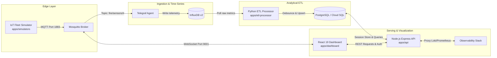

# 🧩 Applications Hub (Microservices Layer)

[](https://nodejs.org/)
[](https://react.dev/)
[](https://www.typescriptlang.org/)
[](https://www.python.org/)
[](https://flywaydb.org/)
[](https://www.docker.com/)

This directory houses the core application microservices powering the **Fire Monitoring System**. Each service is decoupled, independently containerized via hardened multi-stage Docker builds, executed under non-root system users, and orchestrated internally over private Kubernetes networks.

---

## 📂 Microservices Directory Index

| Service | Directory | Language / Stack | Core Architectural Role | Dedicated Guide |
|---|---|---|---|:---:|
| **REST API** | [`api/`](./api/) | Node.js 22, Express, `pg`, `prom-client`, `connect-pg-simple` | Serves authenticated REST endpoints, gates session cookies, proxies Prometheus/Loki metrics, and interfaces with Cloud SQL PostgreSQL. | [**API Guide 📖**](./api/README.md) |
| **Command Center Dashboard** | [`dashboard/`](./dashboard/) | React 19, TypeScript, Vite, Tailwind CSS, MapLibre GL, WebGL | High-performance operator UI featuring 3D spatial telemetry, live MQTT subscriptions, simulation controls, and Loki logs viewer. | [**Dashboard Guide 📖**](./dashboard/README.md) |
| **ETL Processor** | [`etl-processor/`](./etl-processor/) | Python 3.12, `pandas`, `psycopg2`, InfluxDB, `loguru` | Continuous stream processor downsampling routine telemetry (5-min rollups) and debouncing active fire incidents (30-min window) into PostgreSQL. | [**ETL Guide 📖**](./etl-processor/README.md) |
| **IoT Fleet Simulator** | [`simulators/`](./simulators/) | Python 3.12, `paho-mqtt` 2.x | Multi-process IoT edge simulator emulating 10 ESP32 hardware nodes with bi-directional MQTT control and real-world NCR coordinates. | [**Simulator Guide 📖**](./simulators/README.md) |
| **Database Migrations** | [`db-migrations/`](./db-migrations/) | Flyway 10, PostgreSQL | Declarative DDL migrations (`V1`–`V19`) applied as a Kubernetes PreSync Job on ArgoCD Sync Wave 5 prior to service rollouts. | [**Migrations Guide 📖**](./db-migrations/README.md) |

---

## 🏗️ Inter-Service Communication & Data Flow



---

## 🔒 Container Security & Packaging Standards

All application Dockerfiles conform to strict production security standards:
1. **Multi-Stage Builds**: Heavy build compilers (`gcc`, `g++`, `python3`, `npm` dev dependencies) are strictly isolated to builder stages. Runtime containers contain only production binaries and minimal shared libraries.
2. **Non-Root Execution**: Workloads run under dedicated non-root users (`UID 1000` / `GID 1000`, e.g., `node:node`, `simuser`) aligned with Kubernetes Pod Security Standards.
3. **Optimized Layer Caching**: Lockfiles (`package-lock.json`, `requirements.txt`) are copied and installed before copying application code, dramatically reducing CI build times.
4. **Context Hygiene**: Dedicated `.dockerignore` files eliminate local cache directories (`node_modules`, `dist`, `venv`, `.git`) from container build contexts.

---

## 🚦 Local Development

To run all application microservices together locally in Docker Compose:
```bash
make dev-up        # Starts API, Dashboard, ETL, Simulators, InfluxDB, Postgres, and Mosquitto
make dev-logs      # Tails logs from the application containers
make dev-down      # Stops the environment and cleans up volumes
```
For instructions on running on local Kubernetes (Kind) or deploying to staging (GKE Dev), refer to the root [**README.md**](../README.md).
