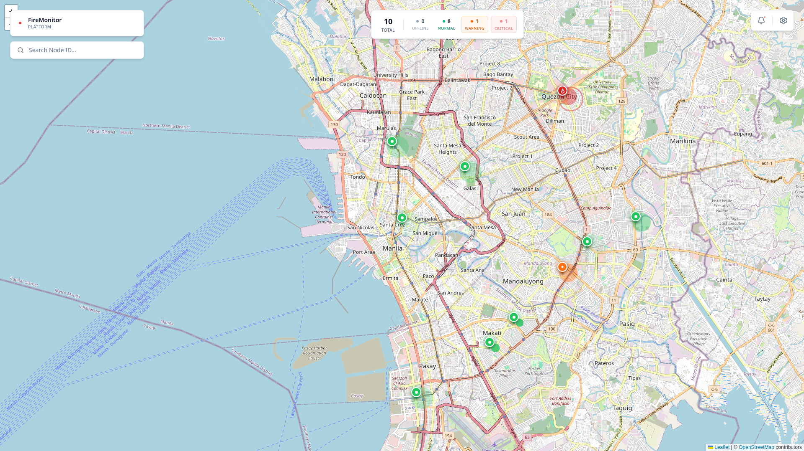
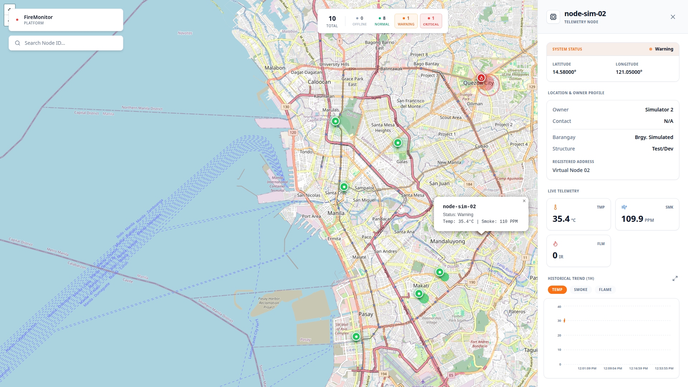
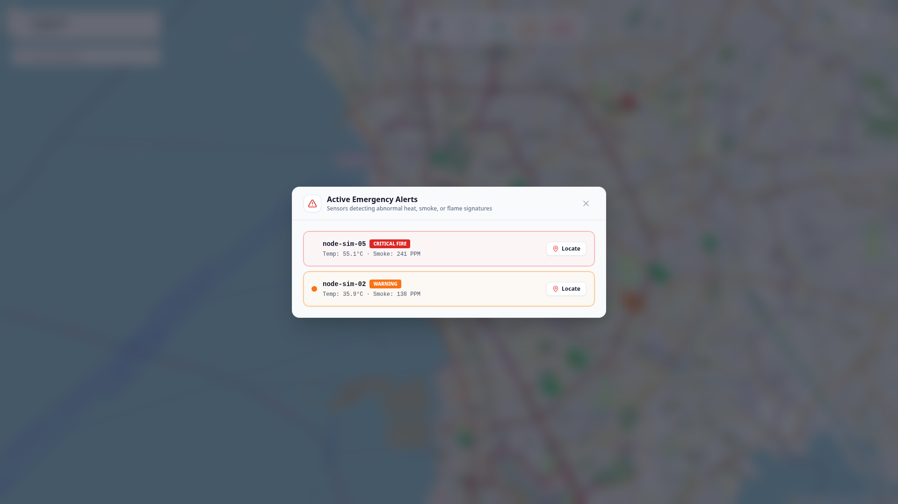
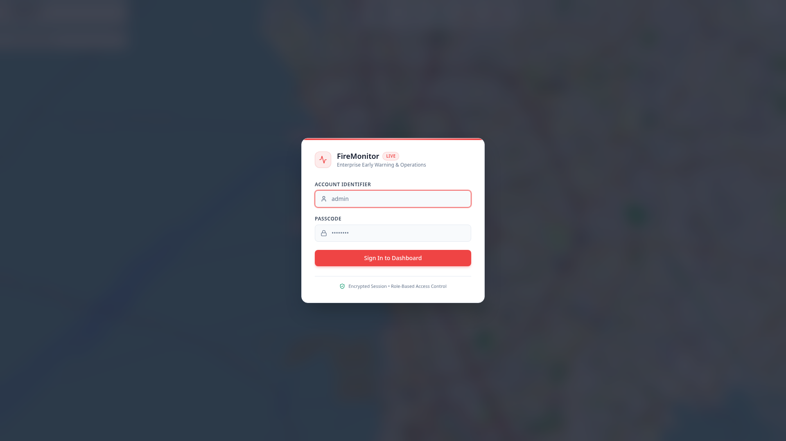

# 🔴 FireMonitor — Command Center Dashboard (`apps/dashboard/`)

[](https://react.dev/)
[](https://vitejs.dev/)
[](https://tailwindcss.com/)
[](https://maplibre.org/)
[](#)

The **FireMonitor Command Center Dashboard** is an AI-optimized, real-time spatial analytics interface built with React 19, Vite, and Tailwind CSS. It visualizes high-frequency IoT sensor telemetry across the National Capital Region (NCR), provides sub-second bi-directional device controls over MQTT WebSockets, and delivers integrated in-cluster observability views (Prometheus metrics & Loki container logs).

---

## 📸 Interface Preview

| Spatial Command Center | Edge Sensor Drawer |
|:---:|:---:|
|  |  |
| *Interactive 3D MapLibre view with live status markers* | *Sub-second telemetry inspection & threshold tracking* |

| Live Simulation Controller | System Diagnostics & Logs |
|:---:|:---:|
|  |  |
| *Bi-directional MQTT simulation controls* | *Encrypted session auth with RBAC gating* |

---

## 🏗️ Architecture & Component Topology

```mermaid
flowchart TD
    subgraph DataSources ["Real-Time Feeds & APIs"]
        MQTT[Mosquitto Broker<br/>ws://host:9001]
        API[Express API<br/>http://host:8000]
    end

    subgraph Hooks ["Reactive State Layer"]
        MQTT -->|Topic: fire/sensors/#| LiveHook[useLiveSensors Hook]
        API -->|Fetch devices & history| DashHook[useDashboardData Hook]
        API -->|Auth verify & session| AuthCtx[AuthContext Provider]
    end

    subgraph UI ["Interactive Command Center Components"]
        LiveHook & DashHook --> Map[MapLibreCanvas / MapCanvas / GlobeCanvas]
        LiveHook --> TopBar[FloatingTopBar & Stats]
        LiveHook --> Drawer[SensorDrawer Inspection Panel]
        LiveHook --> Snackbar[AlertSnackbar Escalations]
    end

    subgraph Modals ["Operator Diagnostic Modals"]
        Map --> CCModal[CommandCenterModal]
        CCModal --> SimModal[SimulatorModal<br/>Publishes fire/control/{h_id}]
        CCModal --> SysDiag[SystemAnalyticsModal<br/>Prometheus CPU/Memory Charts]
        CCModal --> LogView[LogsModal<br/>Loki LogQL Container Stream]
        CCModal --> SensorDiag[SensorAnalyticsModal & ExportModal]
        AuthCtx --> Settings[SettingsModal<br/>User Management & Approvals]
    end
```

---

## ✨ Key Technical Capabilities

### 1. Sub-Second Spatial Visualization (MapLibre & WebGL)
*   **3D Interactive Mapping**: Employs MapLibre GL and Three.js/WebGL (`react-globe.gl`) to project telemetry nodes onto custom vector and satellite maps without proprietary map API keys.
*   **Frame Throttling & Memoization**: Avoids WebGL canvas crashes and re-render thrashing during rapid MQTT packet bursts using `React.memo` and throttled state dispatchers.
*   **Dynamic Alert Markers**: Renders animated pulsing rings and bounding box auto-framing around active incidents in Metro Manila.

### 2. Bi-Directional Device Simulation Controller
*   Operators can control edge IoT hardware in real-time from the **Simulation Controller Modal**:
    *   **Power State**: Toggles device sleep/wake by publishing `{"power": "on"}` or `{"power": "off"}`.
    *   **Alert Overrides**: Forces synthetic sensor status (`0` Normal, `1` Warning, `2` Critical) to validate alerting pipelines.
    *   **Fleet Broadcast**: Issues global resets to all active devices via `fire/control/all`.

### 3. Built-In Cluster Observability (Prometheus & Loki)
*   **System Diagnostics**: Renders real-time pod memory consumption and CPU utilization queried directly from Prometheus via the API observability proxy.
*   **Live Container Logs**: Embeds an interactive LogQL log viewer with search filtering and container alias mapping (`fleet-runner`, `mosquitto`, `postgres|cloud-sql-proxy`, `influxdb`).

### 4. Zero-Placeholder Relational Data
*   All dashboard components consume live data from PostgreSQL, InfluxDB, and Prometheus. Historical analytics graphs (temperature curves, smoke density, hourly alert distributions) are powered by Recharts.

---

## 📡 MQTT WebSocket Topics

| Topic | Flow Direction | Payload Example | Purpose |
|---|---|---|---|
| `fire/sensors/#` | Inbound (Subscribe) | `{"h_id":"node-sim-01","status":2,"temp":68.3,"smoke":0.91}` | Real-time sensor telemetry stream |
| `fire/control/{h_id}` | Outbound (Publish) | `{"power":"on"}` or `{"status_code":2}` | Individual device control command |
| `fire/control/all` | Outbound (Publish) | `{"status_code":0}` | Global fleet override command |

---

## 🏃 Local Development

```bash
cd apps/dashboard
npm install
npm run dev     # Vite dev server running on http://localhost:5173
```

> **Note**: The local Vite development server automatically proxies `/api` and `/auth` requests to the backend API running at `http://localhost:8000`.

### Building Production Assets
```bash
npm run build   # Compiles TypeScript and runs Vite production build to dist/
```

---

## 🐳 Docker Multi-Stage Build

```bash
docker build -t localhost/dashboard:local .
```
* **Stage 1 (Build)**: Compiles TypeScript and bundles static assets via Vite.
* **Stage 2 (Runtime)**: Minimal Nginx Alpine container serving static assets with Gzip compression and configured with `auth_request` reverse proxy gating for secure internal deployments.
