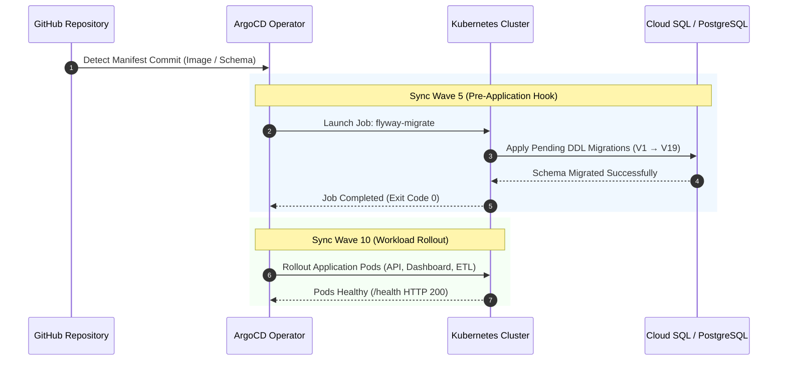

# 🗄️ Database Migrations (`apps/db-migrations/`)

[](https://flywaydb.org/)
[](https://www.postgresql.org/)
[](https://cloud.google.com/sql)
[](https://argoproj.github.io/cd/)

This directory manages declarative DDL schema versioning for the relational PostgreSQL database (Google Cloud SQL in staging/production, PostgreSQL in local environments) using **Flyway 10**.

---

## 🏗️ Architecture & GitOps Execution Lifecycle



---

## 📜 Migration Catalog (`sql/`)

| Version | Migration Script | Description & Schema Impact |
|---|---|---|
| **V1** | `V1__Initial_Schema.sql` | Establishes foundational tables: `users`, `fire_incidents`, and role types. |
| **V2** | `V2__Add_Incident_Alerts.sql` | Introduces structured alert notifications and severity ranking. |
| **V3** | `V3__Official_Incidents_Setup.sql` | Adds official firefighter dispatch reporting and verification status. |
| **V4** | `V4__Add_Final_Sensor_Schema.sql` | Creates `final_sensor_data` table for consolidated sensor records. |
| **V5** | `V5__Final_Sensor_Views.sql` | Implements materialized and analytical views for rapid dashboard queries. |
| **V6** | `V6__Flattened_Architecture.sql` | Flattens legacy nested telemetry fields into high-performance relational columns. |
| **V7** | `V7__Standardize_Timezone_Schema.sql` | Standardizes all database timestamps to `Asia/Manila` (PHT) timezone. |
| **V8** | `V8__Add_Persistent_Sessions.sql` | Creates the `session` table used by `connect-pg-simple` for stateless API pod restarts. |
| **V9** | `V9__Add_Telemetry_Unique_Constraint.sql` | Enforces deduplication constraint on `(h_id, received_at)`. |
| **V10** | `V10__Add_Device_Registry.sql` | Introduces normalized `device_registry` table decoupling hardware from telemetry. |
| **V11** | `V11__Standardize_Device_IDs.sql` | Standardizes naming convention for fleet nodes (`node-sim-01` to `10`). |
| **V12** | `V12__Add_GPS_To_Registry.sql` | Adds geospatial columns (`lat`, `lon`, `barangay`) to `device_registry`. |
| **V13** | `V13__Add_Incident_Metrics.sql` | Adds cumulative average columns for temperature, smoke, and flame in incidents. |
| **V14** | `V14__Optimize_Schema_Footprint.sql` | Drops unused indices and optimizes storage footprint for analytical queries. |
| **V15** | `V15__Restore_Views.sql` | Re-establishes `final_sensor_latest` view with optimized query joins. |
| **V16** | `V16__Remove_Lat_Lon_From_Incidents.sql` | Strictly enforces 3NF normalization by removing duplicate GPS data from incident tables. |
| **V17** | `V17__Seed_Simulated_Devices.sql` | Seeds initial 10 fleet nodes with realistic household owners and structures. |
| **V18** | `V18__Cleanup_Legacy_Dummy_Devices.sql` | Purges legacy test nodes to guarantee clean metrics. |
| **V19** | `V19__Add_Coordinates_To_Simulators.sql` | Seeds high-precision Metro Manila (NCR) GPS coordinates across Manila, Malate, Ermita, Tondo, Sampaloc, and Pandacan. |

---

## 🔒 Cloud SQL & Pod Security

*   **Cloud SQL Auth Proxy Sidecar**: In GKE environments, the `flyway-migrate` Job launches with a Google Cloud SQL Auth Proxy sidecar container, allowing secure, encrypted connection to PostgreSQL without exposing public database ports.
*   **Zero-Downtime Guarantee**: Because Flyway runs in **Sync Wave 5**, backward-compatible schema changes are applied and verified *before* the API or ETL pods deploy in **Sync Wave 10**, preventing runtime SQL syntax errors during deployments.

---

## 📝 Adding New Migrations

1. Add a new SQL file under `apps/db-migrations/sql/` following Flyway naming conventions:
   `V<NextNumber>__<Description>.sql` (e.g. `V20__Add_Device_Status.sql`).
2. Test locally via Docker Compose:
   ```bash
   make dev-up
   ```
3. Commit and push: The GitHub Actions CI/CD pipeline (`app-pipeline.yml`) builds the new migration container image, updates the GitOps overlays, and ArgoCD automatically triggers the Wave 5 migration job.
