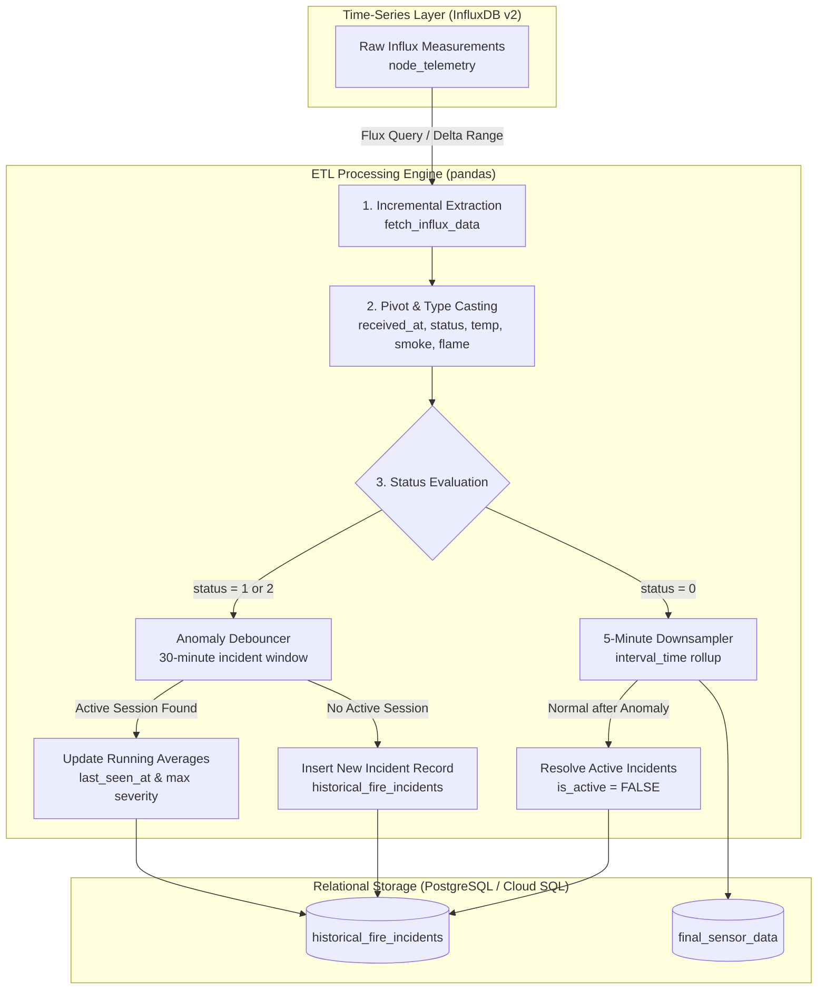

# 🟡 FireMonitor — Python ETL Processor (`apps/etl-processor/`)

[](https://www.python.org/)
[](https://pandas.pydata.org/)
[](https://www.influxdata.com/)
[](https://www.postgresql.org/)
[](#)

The **Python ETL Processor** is a high-throughput background worker service that bridges high-frequency time-series sensor streams in **InfluxDB** with relational analytical tables in **PostgreSQL / Google Cloud SQL**. It prevents database bloat by downsampling routine normal telemetry while applying strict 30-minute debouncing logic to fire incident lifecycles.

---

## 🏗️ Architecture & Pipeline Flow



---

## ⚙️ Core Processing Logic

### 1. Incremental Extraction
*   Executes parameter-driven Flux queries polling the `node_telemetry` measurement.
*   Uses high-watermark timestamp tracking (`received_at + 1ms`) to query only new records arriving since the previous sync cycle, eliminating duplicate data transfers.

### 2. 30-Minute Incident Debouncing
To prevent duplicate alerts during continuous fire emergencies, the ETL engine manages persistent incident lifecycles:
*   **Active Session Lookup**: Checks if an open incident (`is_active = TRUE`) exists for the household ID (`h_id`) with `last_seen_at > NOW() - INTERVAL '30 minutes'`.
*   **Running Weighted Averages**: If an active session exists, the worker updates the incident in-place without creating a new record:
    *   Escalates `status` to `GREATEST(status, max_status)`.
    *   Recomputes cumulative running averages for temperature, smoke density, and flame intensity using `readings_count`.
    *   Extends `last_seen_at` timestamp.
*   **Incident Initiation**: If no active session exists within 30 minutes, a new record is initialized in `historical_fire_incidents`.
*   **Automatic Resolution**: If normal readings (`status == 0`) arrive with timestamps later than the last anomaly, the active incident is marked resolved (`is_active = FALSE`).

### 3. Routine Telemetry Downsampling
*   Routine normal status records (`status == 0`) are aggregated into 5-minute interval buckets (`interval_time = dt.floor("5min")`), reducing PostgreSQL storage consumption by over 90% while preserving historical trend fidelity.

### 4. Normalized 3NF Database Footprint
*   Relational tables store only normalized identifiers (`h_id`, `status`, metrics). Geographic coordinates and metadata reside strictly in `device_registry`, avoiding data duplication.

---

## 🏃 Local Development & Testing

```bash
cd apps/etl-processor
python -m venv venv
source venv/bin/activate
pip install -r requirements.txt

# Run ETL processor locally
python src/main.py
```

### Running Unit Tests
```bash
pytest --tb=short -q
```

---

## 📝 Configuration & Environment Variables

| Variable | Default Value | Description |
|---|---|---|
| `INFLUXDB_URL` | `http://influx:8086` | InfluxDB v2 server endpoint |
| `INFLUXDB_TOKEN` | *Required* | Authentication token for InfluxDB API |
| `INFLUXDB_ORG` | `fire-monitoring` | Target InfluxDB organization |
| `INFLUXDB_BUCKET` | `sensor-data` | Time-series telemetry bucket |
| `INFLUX_MEASUREMENT` | `node_telemetry` | Measurement key for raw telemetry |
| `DATABASE_URL` | *Required* | PostgreSQL / Cloud SQL connection URI |
| `ETL_SYNC_INTERVAL` | `10` | Frequency of ETL execution loop (seconds) |
| `AGG_WINDOW_MINUTES` | `5` | Downsampling aggregation window (minutes) |
| `INFLUX_DEFAULT_RANGE` | `-24h` | Default lookback range for cold starts |

---

## 🐳 Multi-Stage Wheel Builder Dockerfile

```bash
docker build -t localhost/etl-processor:local .
```
The Docker build utilizes a multi-stage wheel compiler architecture:
*   **Stage 1 (Builder)**: Installs development dependencies (`gcc`, `musl-dev`, `libpq-dev`) and compiles all Python requirements into binary `.whl` packages.
*   **Stage 2 (Runtime)**: Minimal `python:3.12-slim` image installing pre-compiled wheels with only runtime `libpq5`, entirely eliminating C-compilers and build headers from production images.
