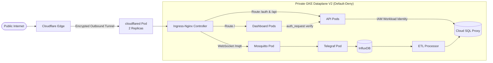

# ☸️ Kubernetes Manifests & GitOps Topology (`infrastructure/k8s/`)

[](https://kubernetes.io/)
[](https://kustomize.io/)
[](https://argoproj.github.io/cd/)
[](https://www.cloudflare.com/)

This directory houses the declarative Kubernetes manifests and Kustomize overlays defining the desired operational state of the **Fire Monitoring Platform**.

---

## 🏗️ Kustomize Directory Hierarchy

The manifests are structured around a template-free **Base & Overlay** model:

```text
infrastructure/k8s/
├── base/                          # Reusable, environment-agnostic domain manifests
│   ├── apps/                      # Microservice workloads (api, dashboard, etl, simulator, flyway)
│   ├── data/                      # In-cluster state (influxdb, mosquitto mqtt, telegraf)
│   ├── observability/             # Monitoring suite (prometheus, loki, alloy, cadvisor, node-exporter)
│   └── networking/                # Ingress routes and Cloudflare tunnel gateway
│
└── overlays/                      # Environment-specific overrides and configuration patches
    ├── local/                     # Local Kind testing (in-cluster postgres, imagePullPolicy: Never)
    ├── dev/                       # Staging environment (dev.fires.systems, single replicas, Cloud SQL)
    └── prod/                      # Production environment (fires.systems, scaled replicas, Let's Encrypt)
```

---

## 📂 Domain Partitioning in `base/`

| Architectural Domain | Path | Workloads & Responsibilities |
|---|---|---|
| **Applications** | [`base/apps/`](./base/apps/) | Stateless application services: `api`, `dashboard`, `etl-processor`, `mcu-simulator-fleet`, and the `flyway-migrate` database migration Job. |
| **Data & Ingestion** | [`base/data/`](./base/data/) | Messaging broker (`mosquitto`), metrics ingestion agent (`telegraf`), and time-series storage (`influxdb`). |
| **Observability** | [`base/observability/`](./base/observability/) | Central metrics scraper (`prometheus`), log datastore (`loki`), DaemonSet log forwarder (`alloy`), and node instrumentation (`cadvisor`, `node-exporter`). |
| **Networking & Ingress** | [`base/networking/`](./base/networking/) | Ingress-Nginx routing rules and Cloudflare Zero Trust Tunnels (`cloudflared`). |

---

## 🌍 Overlay Environments

### 1. Local Sandboxing (`overlays/local/`)
*   **Target Namespace**: `fire-monitoring-local`
*   **Execution**: Designed for local development on **Kind (Kubernetes in Docker)**.
*   **Optimizations**: Disables external image pulls (`imagePullPolicy: Never`), boots an in-cluster PostgreSQL StatefulSet with persistent local volumes, and strips cloud-only tunnel deployments in favor of port-forwarding.

### 2. Staging / Development (`overlays/dev/`)
*   **Target Namespace**: `fire-monitoring-dev`
*   **Domain**: `dev.fires.systems`
*   **Topology**: Single replicas, Cloud SQL Auth Proxy sidecar integration, Cloudflare Tunnel ingress, relaxed rate limits, and automated GitOps tag updates directly on `main` merge.

### 3. Production (`overlays/prod/`)
*   **Target Namespace**: `fire-monitoring-prod`
*   **Domain**: `fires.systems`
*   **Topology**: Scaled replicas (minimum 2 replicas per stateless workload), strict Pod Disruption Budgets, Let's Encrypt TLS certificates (`cert-manager`), aggressive rate-limiting (50 RPS, 10 connections), and promotion via semver Git release tags (`v*.*.*`).

---

## 🔒 Zero-Trust Security & Network Architecture



1. **Cloudflare Zero Trust Ingress**: Inbound traffic does not traverse open public node ports. The `cloudflared` deployment establishes an encrypted, outbound-only tunnel to Cloudflare Edge, shielding the cluster from direct DDoS attacks.
2. **Default-Deny Network Policies**: NetworkPolicies restrict inter-pod lateral movement, granting ingress only to explicitly permitted application channels.
3. **Restricted Pod Security Standards**: Containers run under dedicated non-root UIDs (`UID 1000`), drop all Linux capabilities (`drop: ["ALL"]`), and enforce read-only root filesystems where appropriate.
4. **Application Health Probes**: Upgraded from raw `tcpSocket` checks to deep application HTTP readiness probes (`/health`) that verify active database connection pools.

---

## 🚢 GitOps Release Lifecycle & Sync Waves

> [!IMPORTANT]
> **Strict GitOps Discipline**: Never manually run `kubectl apply -k` against staging (`dev`) or production (`prod`) clusters. Cluster state mutations are governed exclusively through the GitHub Actions CI/CD pipeline and ArgoCD.

ArgoCD continuously reconciles cluster state against this directory using **Sync Waves**:
*   **Sync Wave 5 (Pre-Application Migration)**: The `flyway-migrate` Kubernetes Job executes all pending database migrations (`V1`–`V19`) against PostgreSQL.
*   **Sync Wave 10 (Workload Deployment)**: Only after Wave 5 completes with Exit Code 0, ArgoCD rolls out updated container images for `api`, `dashboard`, and `etl-processor`.

---

## 🛠️ Local Manifest Inspection & Validation

To validate and inspect compiled manifests without applying them to cloud environments:
```bash
# Validate manifest syntax locally across all overlays
make ci-validate

# Or compile manifests directly with Kustomize
kustomize build infrastructure/k8s/overlays/local
kustomize build infrastructure/k8s/overlays/dev
kustomize build infrastructure/k8s/overlays/prod
```
To run the full stack locally in Kind, refer to the [**Local Kind Guide**](../../docs/LOCAL_KIND_GUIDE.md) or execute `make kind-up`.
